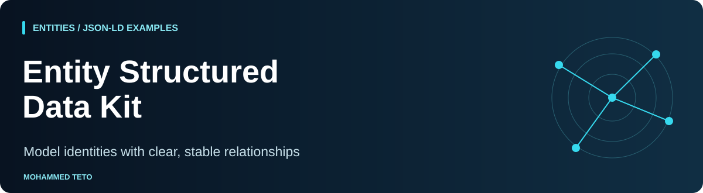

[Models](docs/modeling-guide.md) · [Limits](docs/validator-limits.md) · [Publication checklist](docs/publication-checklist.md) · [Sample report](reports/report.html)

# Entity Structured Data Kit

[](https://github.com/mhdteto/entity-structured-data-kit/actions/workflows/ci.yml)


English, international educational JSON-LD examples for Person, Organization, ProfilePage and Article, with an offline Python structural linter. Keep entity identifiers stable and relationships understandable across pages.

**A clean report means only that this educational subset lint found no issues.** It does not establish full schema.org validity, Google rich result eligibility, factual accuracy, rankings or AI citations. No network access, packages, API keys, telemetry or special “AI schema” are involved.

<!-- shared-nav -->
<p>
  <a href="https://mohammedteto.com"></a>
  <a href="https://mohammedteto.com/method/"></a>
  <a href="https://mohammedteto.com/research/"></a>
</p>

<!-- suite-navigation -->
## Start here: this repository in the workflow

**Your task:** Model connected identities and publication relationships.

[Method →](https://github.com/mhdteto/authority-architecture-system) · [Audit →](https://github.com/mhdteto/search-ai-discoverability-checker) · [Structure →](https://github.com/mhdteto/entity-structured-data-kit) · [Measure →](https://github.com/mhdteto/ai-citation-tracker)

**Next step:** [ai-citation-tracker](https://github.com/mhdteto/ai-citation-tracker) — For a real study, collect dated answers and explicit citations under a protocol.

**Try it:** [complete fictional workflow](https://github.com/mhdteto/authority-architecture-system/tree/main/examples/fictional-workflow) · [this tool’s inputs, command and expected output](examples/connected-workflow/README.md). All scenario records and engine answers are invented; generated reports are real CLI output.

**Python CI:** 3.10 / 3.13. The badge links to the real workflow; it describes automated checks, not ranking, factual accuracy or AI visibility.
[Map of all eight resources](https://github.com/mhdteto/authority-architecture-system/blob/main/docs/tool-map.md) · [Open an issue](https://github.com/mhdteto/entity-structured-data-kit/issues/new/choose)
<!-- /suite-navigation -->

## Quick start

Python 3.10+ supported; standard library only. Also exercised locally on Python 3.9.6.

```sh
python3 validate.py examples/04-article.json --output-dir reports
python3 validate.py --all examples --output-dir reports
python3 -m unittest discover -s tests -v
```

Open `reports/report.html` in a browser or read `reports/report.json`. Each run replaces those two files. Input/output collisions, including resolved paths, symlinks and hardlinks, are checked before writing. Keep a separate report directory; do not change file links during a run.

Exit codes: **0** no structural errors (warnings may exist); **1** lint errors, including syntax/duplicate keys/unreadable input; **2** command usage, output failure or file collision. Recommendations are warnings, never asserted schema.org legal requirements.

## Five connected examples

All people, organizations, publishing activity and copy are fictional. `example.org` is a reserved domain. Do not deploy the examples unchanged.

| Example | What to learn |
|---|---|
| [Person](examples/01-person.json) | Stable person ID independent of their profile page |
| [Organization](examples/02-organization.json) | Separate publisher identity |
| [Person profile](examples/03-person-profile.json) | ProfilePage mainEntity and publisher |
| [Article](examples/04-article.json) | author, publisher and mainEntityOfPage |
| [Organization profile](examples/05-organization-profile.json) | A profile describing an organization |

The [visible-copy companion](docs/example-visible-copy.md) explains the fictional page content these models reflect; it is not a deployed site. Definitions repeat deliberately: each file is independently linted, reusing the same identity IDs.

## What is checked

Strict JSON parsing, duplicate keys, exact supported context, graph shape, duplicate graph IDs, type representation, selected HTTP(S) URL properties, local references and selected relationship targets. Missing recommended fields are warnings. Unknown properties are not vocabulary-validated. Read the [complete boundary](docs/validator-limits.md) before interpreting any report.

The checked-in [JSON](reports/report.json) and [standalone HTML](reports/report.html) were generated by `python3 validate.py --all examples --output-dir reports`. Output has no timestamps, remote resources or machine-specific paths when invoked as shown. CI compares regenerated files byte for byte.

## Related independent tools

[Entity Consistency Auditor](https://github.com/mhdteto/entity-consistency-auditor) compares supplied entity records; [Authority Evidence Mapper](https://github.com/mhdteto/authority-evidence-mapper) organizes claim evidence. See the [method and boundaries](https://mohammedteto.com/method/). These links imply no integration or data collection. This independent project implies no employer, Google or schema.org endorsement.

Official references checked 2026-11-01 are in the [modeling guide](docs/modeling-guide.md). See [CONTRIBUTING](CONTRIBUTING.md), [CHANGELOG](CHANGELOG.md) and [LICENSE](LICENSE). Code/tests/CI: MIT. Docs, examples, reports and original banner: CC BY 4.0.
